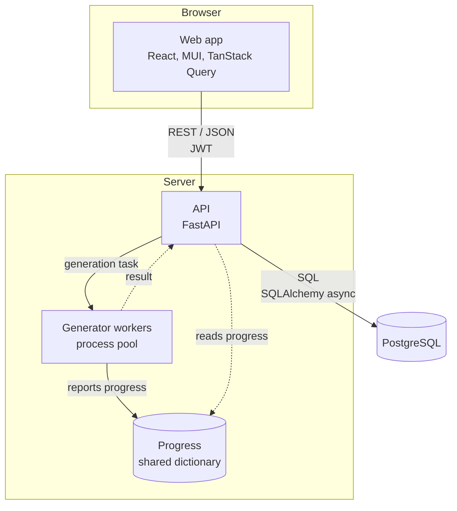
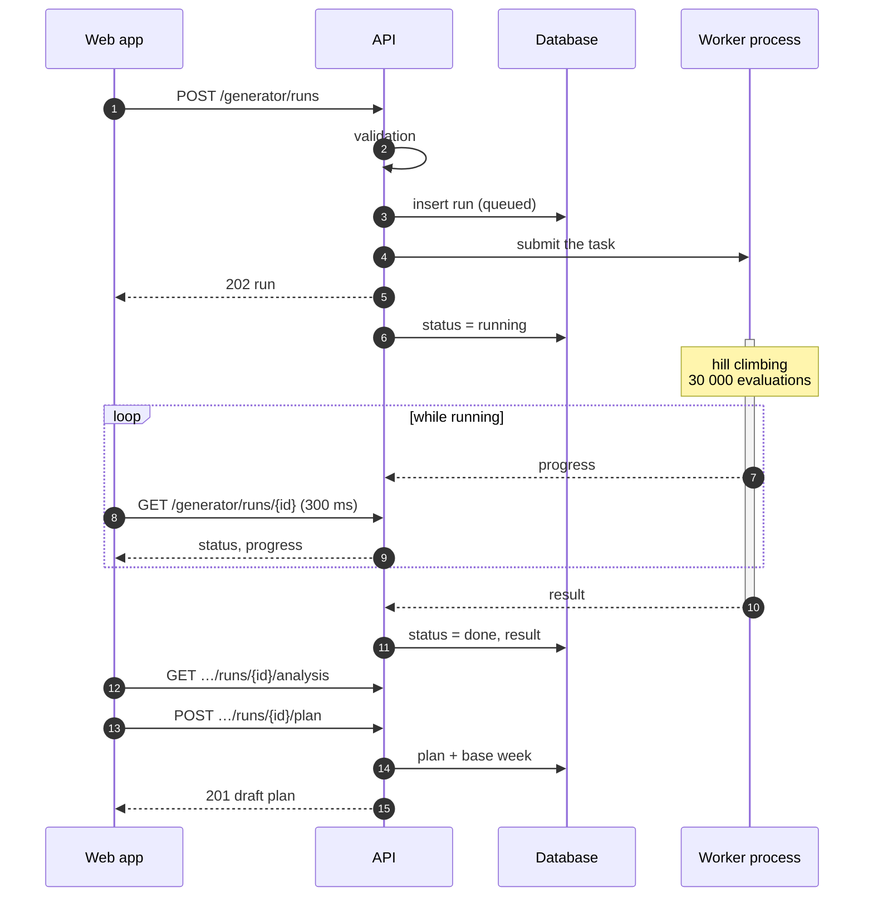
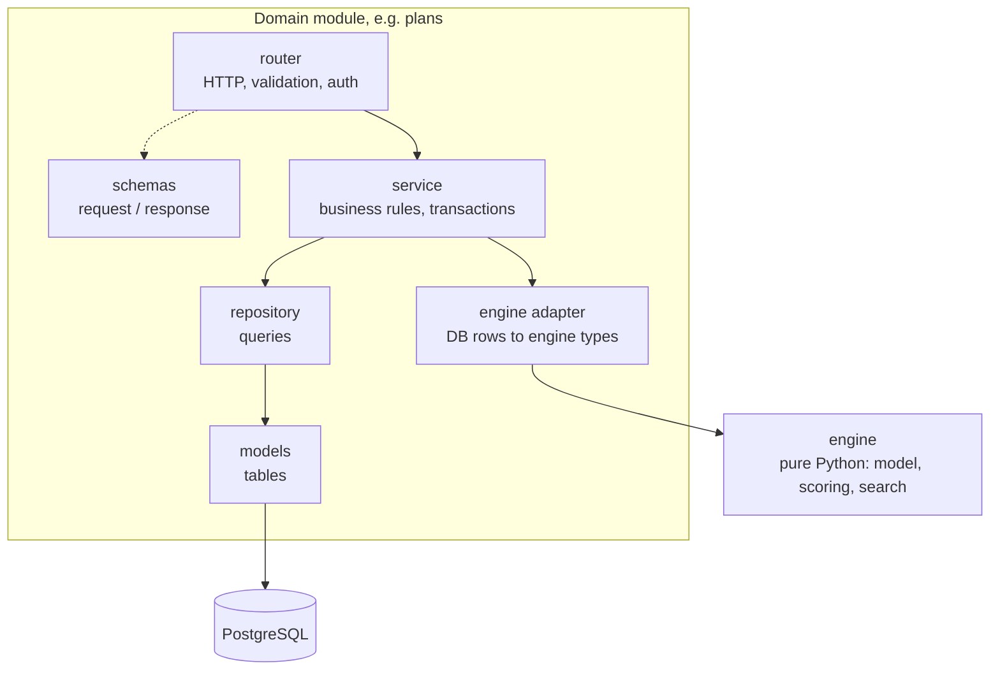
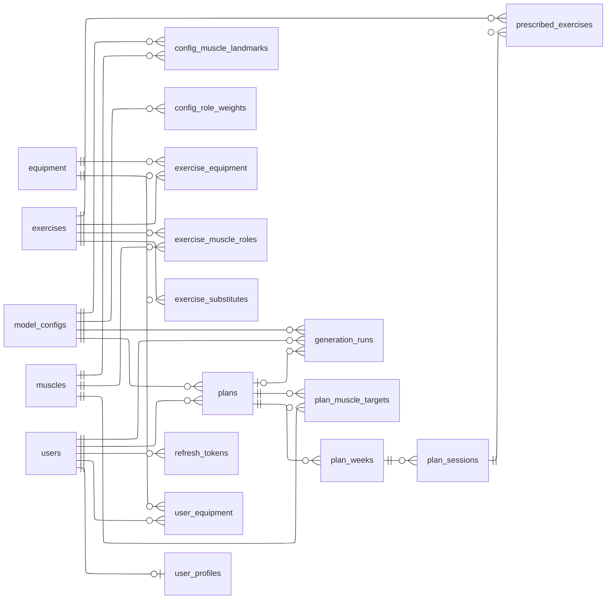
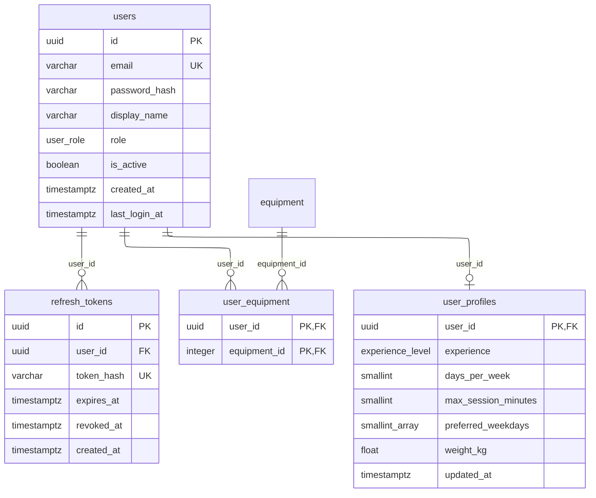
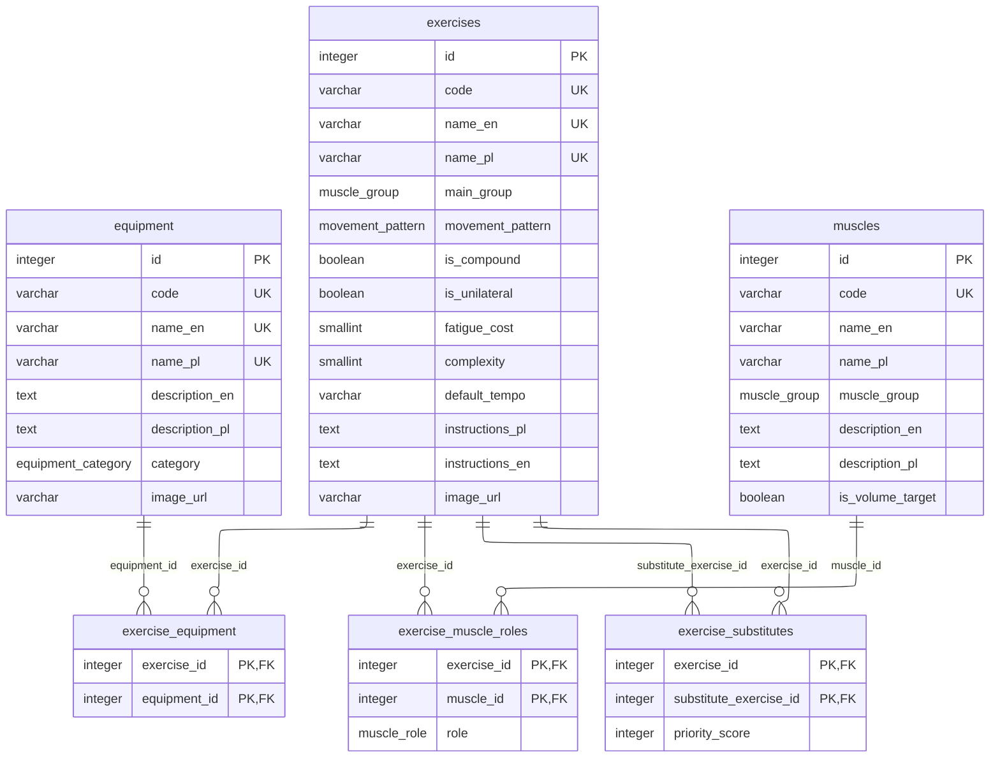
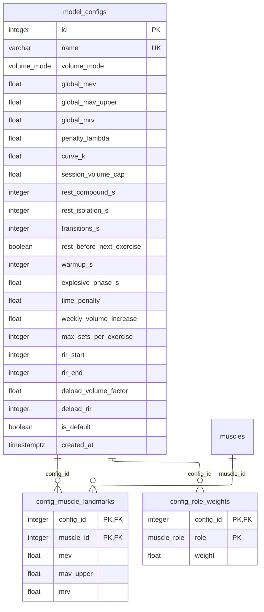
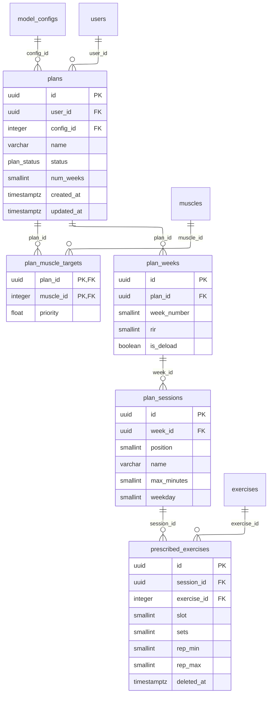
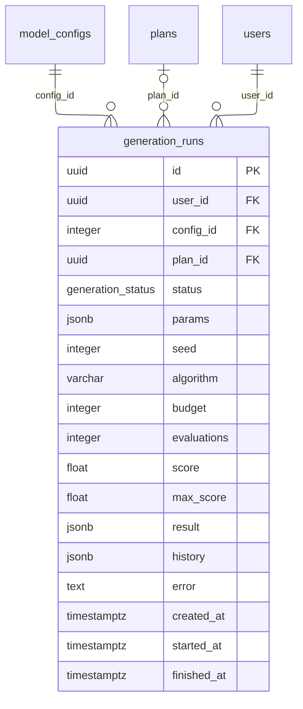

# System diagrams

Generated by `docs/generate.py` from the code and `docs/diagrams/` - do not edit by hand.

## Architecture

## Plan generation

## Backend layers

## Database - overview

## Database - users and authentication

## Database - catalog

## Database - model configuration

## Database - plans

## Database - generation runs

